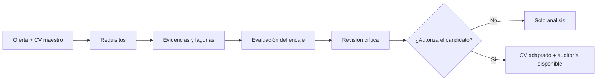

# JobMatch AI

**Análisis de candidaturas y optimización de currículums basada en evidencias mediante IA generativa, Ingeniería de Prompts e Ingeniería de Contexto.**

[English](README.md) · [Prompt maestro v1.3.0](prompts/JOBMATCH_MASTER_v1.3.0.md) · [Original v1.2.0](prompts/PROMPT_MAESTRO_JOB_MATCH_ANALYZER_v1.2.0.md) · [Arquitectura](docs/ARCHITECTURE.md) · [Licencia](LICENSE.md)

**Autor:** Aythami Melián Perdomo · [GitHub](https://github.com/ajmelian) · [LinkedIn](https://www.linkedin.com/in/aythami-melian/)

## Presentación

JobMatch AI es un **framework de instrucciones para modelos de lenguaje (LLM)**, diseñado para analizar ofertas de empleo tecnológico frente a evidencias profesionales y facilitar la preparación de currículums veraces, legibles y adaptados a cada vacante. Aplica Ingeniería de Prompts, Context Engineering, trazabilidad de evidencias, revisión crítica y controles de calidad, con supervisión humana.

**No es un SaaS desplegado, ni una integración con sistemas ATS empresariales, ni un predictor validado de contratación, ni un sistema multiagente autónomo.** Sus seis perspectivas especializadas son simuladas por un único asistente.

### Estado de las versiones

| Versión | Estado | Finalidad |
|---|---|---|
| [v1.2.0](prompts/PROMPT_MAESTRO_JOB_MATCH_ANALYZER_v1.2.0.md) | Base original publicada | Especificación maestra original en español, conservada |
| [v1.3.0](prompts/JOBMATCH_MASTER_v1.3.0.md) | **Borrador genérico en revisión** | Entradas parametrizadas, aislamiento de contexto, idioma y salvaguardas |

La propuesta v1.3.0 se encuentra en el [Pull Request #1](https://github.com/ajmelian/jobmatch-ai/pull/1). Que esté disponible en la rama de trabajo **no significa que se haya fusionado con `main`**. Las evaluaciones con distintos modelos aún no se han ejecutado ni publicado.

## Capacidades especificadas

- **Descomposición de la oferta:** requisitos obligatorios, deseables, implícitos y excluyentes.
- **Análisis basado en evidencias:** las afirmaciones deben tener procedencia identificable; no se presuponen datos ausentes.
- **Indicadores separados:** encaje profesional ponderado, compatibilidad ATS documental estimada y viabilidad de la candidatura.
- **Trazabilidad:** matriz requisito-evidencia, carencias, riesgos, fortalezas y revisión crítica desde perspectivas técnicas y de selección.
- **Validación humana:** preguntas aclaratorias y autorización expresa antes de elaborar un CV adaptado.
- **Auditoría documental:** controles factuales y editoriales; extracción de texto, revisión visual y enlaces **solo cuando las herramientas estén disponibles**.
- **Privacidad:** evitar datos personales en ejemplos públicos y no valorar características personales protegidas.

### Flujo de trabajo



## Cómo empezar

1. Consulta el [manual de uso](docs/USER_GUIDE.md) y elige la versión del prompt.
2. Abre la [v1.3.0](prompts/JOBMATCH_MASTER_v1.3.0.md) si necesitas un flujo genérico, o la [v1.2.0](prompts/PROMPT_MAESTRO_JOB_MATCH_ANALYZER_v1.2.0.md) para consultar el documento original.
3. Proporciona las instrucciones al asistente LLM junto con el texto completo de la oferta (o una URL pública accesible), tu CV maestro y las evidencias verificables.
4. Para la v1.3.0, facilita las entradas `{{CV_MAESTRO}}`, `{{OFERTA}}`, `{{IDIOMA_SALIDA}}`, `{{REGION}}` y, opcionalmente, `{{PREFERENCIAS}}` y `{{EVIDENCIAS_ADICIONALES}}`.
5. Revisa el informe, aclara las dudas y **autoriza expresamente** cualquier adaptación. Comprueba personalmente los datos y el documento final.

**Ejemplo mínimo de sesión (datos ficticios):**

```text
Utiliza las instrucciones de JobMatch AI v1.3.0.
IDIOMA_SALIDA: Español
REGION: España
OFERTA: "Desarrollador backend. Obligatorio: PHP o Go. SQL deseable."
CV_MAESTRO: "Candidato ficticio: dos años desarrollando API REST con PHP; experiencia en SQL."
PREFERENCIAS: Trabajo remoto
Primero presenta el análisis con evidencias. No generes el CV adaptado hasta que lo autorice.
```

No publiques currículums reales ni documentación confidencial. Antes de enviar información personal a un proveedor LLM, revisa sus condiciones de tratamiento y conservación de datos.

## Puntuación y limitaciones

La metodología documenta una valoración ponderada del **encaje profesional** y una estimación **ATS documental independiente** (`85 % adecuación semántica + 15 % legibilidad estructural`). Son **heurísticas internas**, no puntuaciones reales de un ATS, métricas certificadas ni probabilidades de contratación. Una mejora de redacción o formato no debe aumentar el encaje profesional sin nuevas evidencias.

El acceso a enlaces, la escritura de archivos, las exportaciones y la revisión de PDF dependen de las herramientas efectivamente disponibles. Una afirmación del modelo de que ha guardado o comprobado algo no constituye prueba de su ejecución.

## Documentación y ejemplos

| Recurso | Contenido |
|---|---|
| [Arquitectura](docs/ARCHITECTURE.md) | Flujo lógico, interfaces, decisiones y riesgos |
| [Metodología](docs/METHODOLOGY.md) | Estados de evidencia, ponderaciones y límites |
| [Manual de uso](docs/USER_GUIDE.md) | Entradas, funcionamiento y restricciones |
| [Seguridad y privacidad](docs/SECURITY.md) | Inyección de instrucciones, datos personales y uso responsable |
| [Casos sintéticos](examples/README.md) | Cuatro escenarios ilustrativos y resultados esperados |
| [Notas de versión v1.3.0](docs/RELEASE_NOTES_v1.3.0.md) | Cambios y criterios pendientes |
| [Historial](CHANGELOG.md) | Evolución del proyecto |

Los casos sintéticos describen **comportamientos esperados**. No son resultados de pruebas ejecutadas ni acreditan todavía precisión, compatibilidad entre modelos o impacto empresarial.

## Licencia y explotación comercial

Copyright © 2026 **Aythami Melián Perdomo**.

Salvo indicación expresa, los prompts y documentos originales se distribuyen bajo **Creative Commons Atribución–NoComercial 4.0 Internacional (CC BY-NC 4.0)**. Exige atribución y **no autoriza usos comerciales** de los materiales licenciados. El contenido es públicamente accesible, pero **no es software de código abierto conforme a la definición de Open Source**.

- [Aviso de licencia](LICENSE) · [Detalles](LICENSE.md) · [Texto legal oficial](https://creativecommons.org/licenses/by-nc/4.0/legalcode)
- [Licencias comerciales independientes](COMMERCIAL-LICENSING.md): **ajmelper@gmail.com**

La licencia no otorga exclusividad sobre ideas o métodos abstractos. El código ejecutable que pueda añadirse en el futuro podrá tener una licencia de software expresamente diferenciada.
