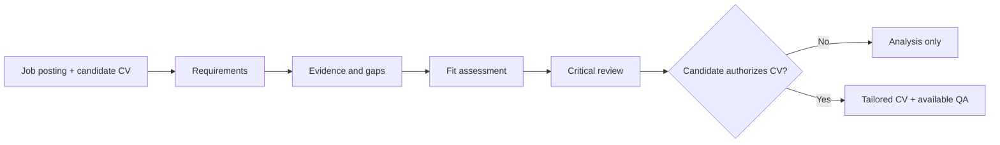

# JobMatch AI

**Evidence-driven job matching and CV optimization through Generative AI, Prompt Engineering and Context Engineering.**

[Español](README.es.md) · [Master prompt v1.3.0](prompts/JOBMATCH_MASTER_v1.3.0.md) · [Original v1.2.0](prompts/PROMPT_MAESTRO_JOB_MATCH_ANALYZER_v1.2.0.md) · [Architecture](docs/ARCHITECTURE.md) · [License](LICENSE.md)

**Author:** Aythami Melián Perdomo · [GitHub](https://github.com/ajmelian) · [LinkedIn](https://www.linkedin.com/in/aythami-melian/)

## Overview

JobMatch AI is an authored, human-supervised **LLM instruction framework**, designed to analyse technology vacancies against a candidate's professional evidence and help prepare truthful, readable, job-specific CVs. It uses structured prompts, evidence traceability, analytical review perspectives and quality gates to make model outputs more auditable.

**This is a prompt methodology, not a deployed SaaS, an employer ATS integration, a validated hiring prediction tool or an autonomous multi-agent system.** The six review perspectives are simulated by one assistant.

### Project status

| Version | Status | Purpose |
|---|---|---|
| [v1.2.0](prompts/PROMPT_MAESTRO_JOB_MATCH_ANALYZER_v1.2.0.md) | Published baseline | Original Spanish master specification, preserved |
| [v1.3.0](prompts/JOBMATCH_MASTER_v1.3.0.md) | **Candidate-neutral draft — under review** | Generic inputs, session isolation, localization and safeguards |

The v1.3.0 proposal is being reviewed in [Pull Request #1](https://github.com/ajmelian/jobmatch-ai/pull/1). Its availability in the feature branch **does not mean it has been released to `main`**. Cross-model evaluations have not yet been run or reported.

## What the methodology specifies

- **Vacancy decomposition:** mandatory, desirable, implicit and exclusionary requirements.
- **Evidence-first analysis:** each candidate claim must be attributable; unknown facts are not assumed.
- **Separate assessments:** weighted professional fit, heuristic ATS-document compatibility and eligibility considerations are reported independently.
- **Traceability:** requirement-to-evidence mapping, gaps, risks, strengths and critical technical/recruitment review.
- **Human checkpoints:** clarifications and explicit authorization before generating a tailored CV.
- **Document QA:** factual and editorial checks, plus text extraction, visual layout and link verification **only when the environment actually supports them**.
- **Privacy safeguards:** avoid publishing real CVs and do not evaluate protected personal characteristics.

### Workflow



## Getting started

1. Read the [usage guide](docs/USER_GUIDE.md) and select a prompt version.
2. Open [v1.3.0](prompts/JOBMATCH_MASTER_v1.3.0.md) for candidate-neutral use, or [v1.2.0](prompts/PROMPT_MAESTRO_JOB_MATCH_ANALYZER_v1.2.0.md) for the original specification.
3. In an LLM chat, provide the instructions together with the complete job posting (or an accessible public URL), your master CV and any verifiable supporting facts.
4. For v1.3.0, populate or supply the session inputs: `{{CV_MAESTRO}}`, `{{OFERTA}}`, `{{IDIOMA_SALIDA}}`, `{{REGION}}` and, optionally, `{{PREFERENCIAS}}` and `{{EVIDENCIAS_ADICIONALES}}`.
5. Review the analysis, resolve uncertainties and **explicitly approve** any CV adaptation. Check the final file and every factual claim yourself.

**Minimal session example (fictional data):**

```text
Use the JobMatch AI v1.3.0 instructions above.
IDIOMA_SALIDA: English
REGION: Spain
OFERTA: "Backend developer. Required: PHP or Go; SQL desirable."
CV_MAESTRO: "Fictional candidate: two years developing PHP REST APIs; SQL experience."
PREFERENCIAS: Remote work
First produce the evidence-based analysis. Do not create a tailored CV until I authorize it.
```

Do not submit private candidate information to public repositories or services without evaluating their data-processing conditions.

## Scoring and limitations

The documented methodology uses a weighted **professional-fit rubric** and a separate internal **ATS-document estimate** (`85% semantic fit + 15% structural readability`). These are **heuristic editorial assessments**, not actual employer ATS scores, certified matching metrics or probabilities of hiring. Formatting improvements must not increase professional-fit scores without new supporting evidence.

Model adherence, URL retrieval, file saving, export and PDF inspection depend on the tools actually available. Never treat an LLM's assertion that an action was performed as proof of execution.

## Documentation and examples

| Resource | Description |
|---|---|
| [Architecture](docs/ARCHITECTURE.md) | Logical pipeline, interfaces, design decisions and risks |
| [Methodology](docs/METHODOLOGY.md) | Evidence categories, weights and scoring caveats |
| [Usage guide](docs/USER_GUIDE.md) | Inputs, workflow and operating limitations |
| [Security and privacy](docs/SECURITY.md) | Prompt-injection, personal data and responsible use |
| [Synthetic fixtures](examples/README.md) | Four illustrative scenarios and expected outcomes |
| [v1.3.0 release notes](docs/RELEASE_NOTES_v1.3.0.md) | Changes and outstanding acceptance criteria |
| [Changelog](CHANGELOG.md) | Project history |

The fixtures document **expected behavior only**. They are not recorded benchmark executions. No measured accuracy, portability or business impact is claimed.

## Licensing and commercial use

Copyright © 2026 **Aythami Melián Perdomo**.

Unless stated otherwise, the original prompts and documentation are licensed under **Creative Commons Attribution–NonCommercial 4.0 International (CC BY-NC 4.0)**. Attribution is required, and the public license does **not** authorize commercial use of the licensed material. This is **source-available content, not an OSI-approved open-source license**.

- [License notice](LICENSE) · [License details](LICENSE.md) · [Official legal code](https://creativecommons.org/licenses/by-nc/4.0/legalcode)
- [Separate commercial licensing](COMMERCIAL-LICENSING.md): **ajmelper@gmail.com**

The license does not grant exclusivity over abstract ideas or methods. Future executable code may carry its own expressly stated software license.
