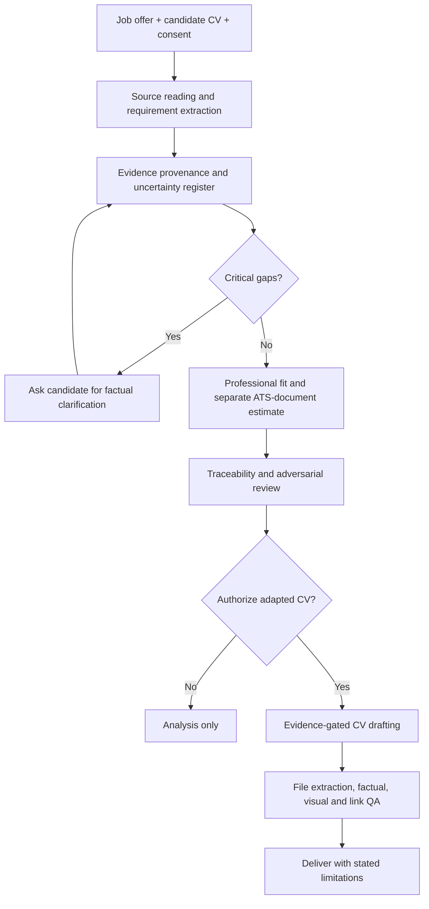

# Architecture — JobMatch AI

## Scope

JobMatch AI is a **prompt-defined, human-supervised workflow**. Its six specialist perspectives are analytical lenses emulated by one LLM response, not six independent agents. The specification does not implement an ATS parser, scraper, persistent database or automated recruitment decision.

## Logical pipeline

## Architecture decisions

1. **Evidence first:** master CV + explicit statements + sources actually read. Outputs and model inference are not primary evidence.
2. **Two independent metrics:** professional suitability measures supported competence; ATS-document fit estimates visibility and extractability only. Formatting changes never improve professional fit.
3. **Human checkpoint:** no adapted CV without explicit permission.
4. **Fail closed:** critical unsupported claims are excluded from deliverables, not merely labeled inside a public CV.
5. **Persistence honesty:** stating that a file has been updated requires a real write and read-back.
6. **No hiring decision:** model scores are heuristic, not employer ATS scores or hiring probabilities.
7. **Data minimization:** no private CVs or identifiable candidate data in public issue reports, fixtures or logs.

## Interfaces

Inputs: `CV_MAESTRO`, `OFERTA`, `IDIOMA_SALIDA`, `REGION`, optional `PREFERENCIAS` and `EVIDENCIAS_ADICIONALES`.

Outputs: analytical report; optional adapted CV only after candidate authorization; evidence and QA summary where supported by tools.

## Known risks

Prompt injection through job postings, hallucinated experience, inconsistent model scoring, privacy disclosure, output-format drift, falsely claimed file persistence, and overstating ATS compatibility. Mitigations are specified instructions, not proven enforcement controls. Empirical evaluation is required.
