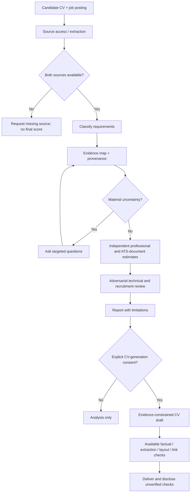

# JobMatch AI — Architecture / Arquitectura

**Version:** 1.3.0 draft · **Type:** LLM instruction specification · [Project](../README.md) · [Español](../README.es.md)

## Scope and boundaries

JobMatch AI specifies an evidence-based, **human-supervised** workflow. A single model simulates six specialist review perspectives. It does **not** deploy six agents, perform real employer ATS processing, implement a database, or make hiring decisions.

**Input contract:** `{{CV_MAESTRO}}`, `{{OFERTA}}`, `{{IDIOMA_SALIDA}}`, `{{REGION}}`, optionally `{{PREFERENCIAS}}` and `{{EVIDENCIAS_ADICIONALES}}`. An inaccessible URL or missing CV is an input failure, not permission to guess.

## Logical workflow

## Design principles

1. **Evidence provenance.** The candidate CV and other actually examined sources support claims; prior model outputs are not evidence.
2. **Separate dimensions.** Professional fit assesses supported job competence; document/ATS compatibility estimates matching and readability. Editing alone cannot improve professional competence.
3. **Eligibility is a separate gate.** Explicit exclusion criteria are not masked by a weighted score.
4. **Consent.** Analysis and CV generation are distinct user decisions.
5. **Factual veto.** Unsupported credentials, dates, experience and claimed tools are excluded until verified.
6. **Tool honesty.** Web access, file persistence, PDF extraction and visual checks are conditional capabilities. A claimed action without an actual tool result is unverified.
7. **Personal-data minimization.** Each candidate session is isolated; public fixtures must be synthetic.
8. **No protected-attribute scoring.** Do not use inferred age, health, origin, religion or other protected traits as suitability criteria.

## Output contract

- Structured requirement matrix with evidence and unknowns.
- Independent suitability and document-compatibility **heuristics**, with explanations.
- Material gaps, exclusions, questions and critical review.
- Optional CV adapted from confirmed facts, only after explicit approval.
- QA summary that identifies which checks were executed versus impossible.

## Trust boundaries and risks

Job advertisements, CV files and retrieved web content are **untrusted input data** for instruction-following purposes. Risks include prompt injection, fabricated evidence, score instability, leaking personal data and incorrect assertions about exported documents. The prompt's safeguards are design requirements, **not demonstrated security guarantees**.

**Sources:** [v1.3.0 specification](../prompts/JOBMATCH_MASTER_v1.3.0.md), [methodology](METHODOLOGY.md), [security](SECURITY.md), [fixtures](../examples/README.md).
